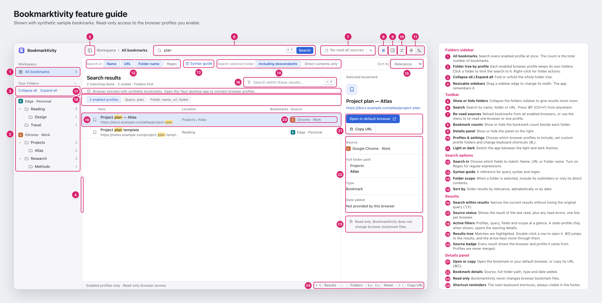

# Bookmarktivity

**Search every bookmark in every browser profile from one keyboard-driven desktop app.**

Bookmarktivity reads the local bookmarks of the Edge, Chrome, Brave, Firefox, and Safari profiles you choose and gives you one fast place to search, filter, and open them. It runs outside the browser and never changes browser files.



<sub>Shown with synthetic sample bookmarks. Numbers match the legend on the right.</sub>

## Why Bookmarktivity

- **Find it fast in large collections.** Fuzzy, phrase, field, Boolean, and regex search across all enabled profiles at once, with layered filters on top.
- **Keep your hands on the keyboard.** Every common action has a shortcut, and you can reassign them.
- **Works where extensions can't.** A standalone app for browsers whose extensions are unavailable or blocked by corporate policy.
- **Always know where a bookmark lives.** Every result shows its browser and profile. Distinct profiles are never merged.
- **Read-only and local.** Only the profiles you enable are read, bookmark data stays in memory, and browser files are never written.

## Supported browsers

| Browser | Platforms | What is read |
| --- | --- | --- |
| Microsoft Edge, Google Chrome, Brave | macOS, Windows, Linux | Clear-text `Bookmarks` and `AccountBookmarks` files |
| Firefox | macOS, Windows, Linux | An in-memory image of `places.sqlite`, including committed changes from a running Firefox |
| Safari | macOS (and the discontinued Safari for Windows) | `Bookmarks.plist`, without the Reading List. macOS requires Full Disk Access. |

You choose which profiles to include in **Profiles & settings**. See [Project status](#project-status) for platform validation and known limits.

## Search in seconds

Type in the search bar (<kbd>⌘F</kbd> / <kbd>Ctrl+F</kbd>). These query forms can be combined:

| Type this | To find |
| --- | --- |
| `project plan` | Fuzzy matches: substrings or nearby words despite small spelling differences |
| `"Project plan"` | That exact phrase anywhere in a selected field, even inside a longer word or name |
| `name:guide` · `url:docs.example.com` · `folder:Research` | Matches in one field only. `folder:` matches a folder's own name or a bookmark's immediate folder. |
| `url:docs.example.com AND name:guide` | Both conditions. Adjacent terms imply `AND`, and `AND` takes precedence over `OR`. |
| `design OR research` | Either condition |
| Regex mode + `^https://.*\.example\.com/` | A case-insensitive regular expression, run in a time-limited background worker |

Then narrow down:

- **Search within results** (<kbd>⌥F</kbd> / <kbd>Alt+F</kbd>) filters the current results while keeping the original query and folder scope. For example, search `folder:Research`, then search within for `2026`.
- **Scope to a folder** by selecting it in the sidebar, and choose **Including descendants** or **Direct contents only**. Folder-name matching and folder scope are separate controls.
- **Pick the fields** to search: any combination of Name, URL, and Folder name. Text matching is case-insensitive.
- **Sort** by relevance or alphabetically, or by created and modified date when the browser provides them.
- **Explore matching folders.** A standalone folder-name search lists folders whose names match and lets you expand their full contents, even items that don't match the name. Other search modes show matching items only.

Matching text is highlighted, active filters stay visible above the results, and invalid query syntax is reported in the results area. Searches run in a background worker, so large collections stay responsive. Text searches show progress until the latest one finishes.

## Keyboard shortcuts

| | Action | macOS | Windows and Linux |
| --- | --- | --- | --- |
| **Search** | Focus global search, return to All bookmarks, and clear the within-results filter | <kbd>⌘F</kbd> | <kbd>Ctrl+F</kbd> |
| | Focus Search within results | <kbd>⌥F</kbd> | <kbd>Alt+F</kbd> |
| | Move from either search field into results | <kbd>↓</kbd> | <kbd>↓</kbd> |
| | Reset the query, filters, folder scope, sort, and result expansion | <kbd>Esc</kbd> <kbd>Esc</kbd> | <kbd>Esc</kbd> <kbd>Esc</kbd> |
| **Navigate** | Focus the selected result, or the empty-results area | <kbd>⌘G</kbd> | <kbd>Alt+R</kbd> |
| | Move through visible folder or result rows | <kbd>↑</kbd> <kbd>↓</kbd> | <kbd>↑</kbd> <kbd>↓</kbd> |
| | Jump to the first or last visible result | <kbd>Home</kbd> <kbd>End</kbd> | <kbd>Home</kbd> <kbd>End</kbd> |
| | Expand or enter a folder; collapse or move to its parent | <kbd>→</kbd> <kbd>←</kbd> | <kbd>→</kbd> <kbd>←</kbd> |
| | Expand the focused folder and its descendants | <kbd>⌘E</kbd> | <kbd>Ctrl+E</kbd> |
| | Collapse the focused folder and its descendants | <kbd>⌘⇧E</kbd> | <kbd>Ctrl+Shift+E</kbd> |
| **Act** | Open the selected bookmark or folder | <kbd>Enter</kbd> | <kbd>Enter</kbd> |
| | Copy the selected bookmark URL when results have focus | <kbd>⌘C</kbd> | <kbd>Ctrl+C</kbd> |
| | Open Profiles & settings | <kbd>⌘,</kbd> | <kbd>Ctrl+,</kbd> |

- **Reassign shortcuts** in Profiles & settings › Keyboard shortcuts. You can reassign the search, results, copy, settings, and branch shortcuts. Settings detects duplicate bindings and can restore the defaults. Arrow keys, <kbd>Enter</kbd>, and double <kbd>Esc</kbd> are fixed.
- **Search keeps your query:** <kbd>⌘F</kbd> / <kbd>Ctrl+F</kbd> keeps the primary query so you can revise it.
- **Reset keeps your profiles:** double <kbd>Esc</kbd> doesn't change which profiles are enabled.
- **Tab navigation works:** <kbd>Tab</kbd> and <kbd>Shift+Tab</kbd> move through controls with a visible focus ring.

## Browse and act

- **Navigate folders and results as trees.** Result folders start collapsed, and opening one reveals its immediate children. Expand or collapse a selected branch, or everything in **Your Folders**.
- **Keep context visible.** The details panel shows the selected item's source and full folder path. Optional folder counts include bookmarks in subfolders.
- **Open and copy quickly.** Open a bookmark in your default browser or copy its URL. Opening a folder navigates into it or expands it.
- **Re-read only what you need.** Refresh all enabled profiles, one browser, or one profile. Your current query and scope are reapplied, and read failures are reported per profile.
- **Arrange your workspace.** Show, hide, and resize the folder and details sidebars, and switch between light and dark themes.

## Get started

Install Node.js 20+ and a Rust toolchain, then run the desktop app in development mode:

```sh
npm install
npm run tauri -w @bookmarktivity/desktop -- dev
```

Open **Profiles & settings**, choose **Find profiles** for each browser, and enable the profiles you want to search.

On macOS 27, automatic profile discovery may need Full Disk Access:

1. If no profiles appear, open **Profiles & settings** and click **Open Full Disk Access settings**.
2. Add or enable Bookmarktivity in System Settings.
3. Return to the app and click **Find profiles** for each browser.

Only you can grant this permission. **Choose folder…** works for custom browser user-data locations, but it doesn't give access to protected default locations. Browser files remain read-only either way.

`npm run dev` starts a browser-only preview with synthetic bookmarks. `npm run build` builds only the frontend; to package the desktop app, see [Build installers](#build-installers).

### Tests

```sh
npm test                                                           # browser-neutral search tests
cargo test --manifest-path packages/browser-chromium/Cargo.toml    # also browser-firefox, browser-safari
cargo check --manifest-path apps/desktop/src-tauri/Cargo.toml      # native host
```

## Build installers

Run these commands from the repository root (the directory containing the top-level `package.json`). Packaging builds the frontend and the Rust host. `-w @bookmarktivity/desktop` selects the desktop npm workspace, and `--` passes the remaining arguments to the Tauri CLI.

<details>
<summary><strong>macOS (.app and DMG)</strong></summary>

Install Node.js 20+, Rust, and Xcode Command Line Tools (`xcode-select --install`). Then run:

```sh
npm ci
npm run tauri -w @bookmarktivity/desktop -- build
```

This creates `apps/desktop/src-tauri/target/release/bundle/macos/Bookmarktivity.app` and a DMG in `apps/desktop/src-tauri/target/release/bundle/dmg/`. To build only the `.app`, add `--bundles app` after `build`.

</details>

<details>
<summary><strong>Windows (NSIS setup .exe)</strong></summary>

On a 64-bit Windows PC, install Node.js 20+, Rust with the MSVC toolchain, and Microsoft C++ Build Tools with **Desktop development with C++** selected. Tauri also requires the WebView2 runtime, which is usually present on current Windows systems. In PowerShell, run:

```powershell
npm ci
npm run tauri -w @bookmarktivity/desktop -- build --bundles nsis
```

The NSIS setup `.exe` appears in `apps\desktop\src-tauri\target\release\bundle\nsis\`. `--bundles nsis` builds the setup executable without also requesting an MSI package. See the [Tauri Windows prerequisites](https://v2.tauri.app/start/prerequisites/) if a required tool is missing.

Before transferring an installer, verify that it is a Windows executable and record its SHA-256:

```powershell
Get-ChildItem .\apps\desktop\src-tauri\target\release\bundle\nsis\*-setup.exe |
  ForEach-Object { node scripts/check-windows-installer.mjs $_.FullName }
```

On the destination PC, run `Get-FileHash <installer-path> -Algorithm SHA256` in PowerShell and compare it with the build PC's hash. A `.exe` filename alone does not establish that the file contains a valid installer.

</details>

These local packages are unsigned. Before distributing them publicly, follow the signing, notarization, and testing guidance in [release preparation](releases/README.md) and [Windows distribution](docs/windows-distribution.md).

## Project status

The first usable desktop implementation is in place. Real profile access runs only in the Tauri app; the browser preview uses synthetic bookmarks. An [HTML mockup of this README](docs/readme-mockup.html) shows an alternative presentation.

**Platforms**
- **macOS:** the native app has been compile-checked.
- **Builds:** an Apple Silicon DMG and a Windows x64 NSIS installer can be built locally.
- **Windows:** installation and webview behavior still need validation before a public release.
- **Linux:** packaging is unvalidated.
- **Unsigned installers:** Windows test installers are unsigned. See [Windows distribution](docs/windows-distribution.md) for managed-PC testing and signing requirements.

**Browser sources**
- **Chromium-based browsers (Edge, Chrome, Brave):**
  - Encrypted bookmark stores are decrypted and preferred, as the browser does. On macOS, the first read asks for Keychain access to the browser's "Safe Storage" item.
  - If decryption fails, for example because Keychain access was declined, Bookmarktivity shows the clear-text snapshot with a "possibly stale" warning. If there is no clear-text copy, that profile's read fails and its previously loaded results are removed.
  - Windows app-bound (`v20`) and Linux keyring (`v11`) encryption are not supported. Windows decryption still needs validation on a real profile. See [ADR 0011](docs/decisions/0011-encrypted-chromium-bookmark-stores.md).
- **Firefox:** tags, separators, and saved history queries are not included.
- **Firefox and Safari:** the readers are tested with synthetic data and still need validation against real installations on each platform.

Manual release preparation is documented in [releases/README.md](releases/README.md). Product scope and open decisions are in [PRODUCT.md](PRODUCT.md), and implementation boundaries are in [TECHNOLOGY.MD](TECHNOLOGY.MD).

## Repository map

| Path | Purpose |
| --- | --- |
| `apps/desktop/` | Desktop user interface and platform packaging |
| `packages/core/` | Browser-independent bookmark models and productivity features |
| `packages/browser-edge/` | Edge profile discovery |
| `packages/browser-chrome/` | Chrome profile discovery |
| `packages/browser-brave/` | Brave profile discovery |
| `packages/browser-chromium/` | Shared read-only Chromium bookmark parser |
| `packages/browser-firefox/` | Firefox profile discovery and read-only `places.sqlite` reader |
| `packages/browser-safari/` | Safari `Bookmarks.plist` reader |
| `packages/browser-model/` | Browser-neutral records shared by the adapters |
| `fixtures/` | Synthetic, non-personal browser data for development and tests |
| `docs/architecture.md` | System boundaries and data flow |
| `docs/decisions/` | Recorded product and architecture decisions |
| `docs/images/` | README images, captured with synthetic data |
| `apps/desktop/wireframe.html` | Interactive desktop wireframe using synthetic bookmarks |
| `PRODUCT.md` | Product scope and terminology |
| `TECHNOLOGY.MD` | Selected technology direction and implementation boundaries |
| `BUG.md` | Dated bug descriptions, issues, and fixes |
| `AGENTS.md` | Guidance for coding agents |

## License

Bookmarktivity is licensed under the [MIT License](LICENSE).
